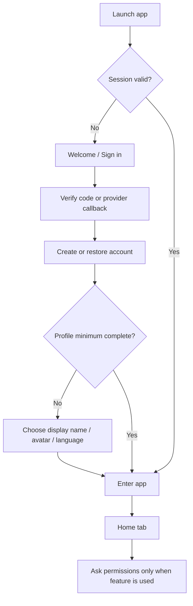
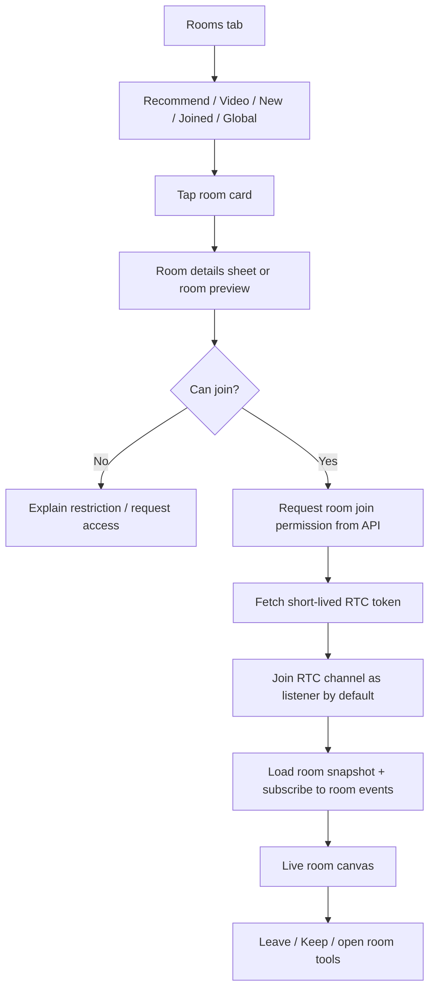
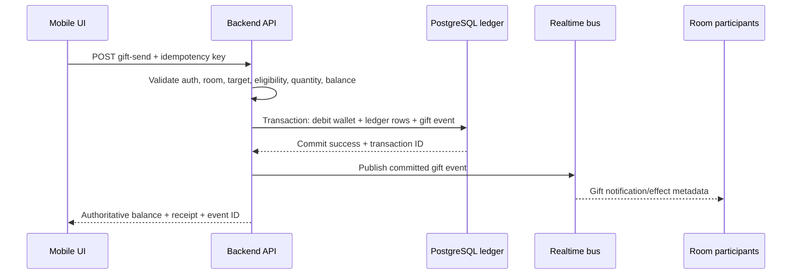

# Social Voice App — Architecture, Product Flows, and AI Build Brief

**Document type:** implementation blueprint and coding-agent context  
**Product direction:** an original social discovery + live voice-room + gifting app informed by the 100 supplied SUGO screenshots  
**Primary client:** iOS and Android, React Native  
**Status:** proposed architecture; not a claim about SUGO's internal implementation  
**Reference analysis:** `sugo_screen_by_screen_analysis.md`  
**Date prepared:** 2026-10-18

---

## 0. How an AI coding agent must use this document

Treat this file as the product and architecture source of truth for the first implementation pass. Read it completely before writing code, then read `sugo_screen_by_screen_analysis.md` for the detailed visual context of each screen ID. The screenshot report describes *what is visible*. This document describes *how our original product should be structured and built*.

### Core instructions

1. Build an **original product** using the screenshots as structural and interaction inspiration. Do not reuse SUGO logos, trade dress, proprietary artwork, exact branded copy, user identities, or screenshots as production assets. Create a distinct name, color tokens, assets, copy, and visual signature.
2. Build a real, maintainable application—not a static screenshot gallery. Components must have typed props, explicit loading/error/empty states, and clear state ownership.
3. Start with a short repository audit. Inspect the existing files and preserve working code where reasonable. If the repository is empty, initialize the architecture described below. Do not overwrite files without reading them first.
4. Implement one vertical slice at a time and keep the app runnable after each slice. Do not generate every page in one massive component.
5. Separate **durable server data**, **ephemeral realtime state**, and **local presentation state**. Do not store authoritative coin balances, payment success, membership entitlements, room ownership, or gift outcomes only on the client.
6. Never invent backend endpoints, SDK APIs, product prices, gift odds, or unverified interactions. Add interfaces and TODOs where the backend/provider decision is still open; label demo data as mock data.
7. Before installing a package or selecting native SDK versions, verify compatibility with the Expo SDK pinned by the project. Prefer `npx expo install` for Expo-managed native dependencies and run Expo's dependency checks.
8. At the end of each implementation task, report: files changed, behavior implemented, commands/checks run, known issues, and the next smallest useful step.

### What success looks like

The first production-quality milestone is not “all 100 screens are drawn.” It is a coherent app foundation in which a user can sign in, discover a person or room, open a profile, enter a room shell, see realistic seats/chat/gifts, navigate to messages, and return without losing the expected state. Financial and real-time features should initially use explicit development adapters, then be connected to validated server/provider implementations.

---

## 1. Product definition

### 1.1 Product concept

Build a mobile social platform focused on:

- discovering people, communities, moments, and live voice rooms;
- joining a voice room as a listener and, when permitted, taking a seat to speak;
- room chat and one-to-one messaging;
- sending virtual gifts and viewing gift effects;
- forming friend/couple-style relationships and tracking shared progress;
- memberships, levels, privileges, store inventory, and rewards;
- user-created posts, room/family discovery, notifications, and safety tools.

The screenshot archive demonstrates the breadth of the product surfaces, not proof that each surface must ship in the first release. Scope the first MVP around the smallest set of working flows below, then add catalog/membership/family depth incrementally.

### 1.2 Primary bottom navigation

The five persistent destinations evidenced by the supplied screenshots are:

1. **Home** — people discovery: Recommend, Nearby, New users, Featured.
2. **Moments** — social feed, post details, likes/comments, media.
3. **Rooms** — room discovery: Recommend, Video, New, Joined, with a Global/discovery view where appropriate.
4. **Messages** — inbox, contacts, direct conversations, system messages and room invitations.
5. **Me** — profile/account dashboard, wallet and diamonds, store/backpack, tasks, levels, membership entry points, visitors and settings.

Tab labels, exact behavior, and which views appear as nested tabs must be confirmed during prototyping. Keep the overall information architecture stable unless product testing shows a real issue.

### 1.3 Core users and permissions

A user may be a visitor, room listener, room speaker, room host/moderator, creator, family member, paying member, or a combination. Do not encode these roles as one global Boolean. Permissions are **resource-scoped**:

- room role: listener, speaker/seat occupant, host, moderator;
- conversation role: participant, conversation moderator if applicable;
- community/family role: member, owner/admin;
- membership tier: a set of entitlements, separate from moderation roles.

UI may hide or disable an action for convenience, but the backend must authorize every mutation.

### 1.4 Product principles

- **Fast discovery:** list pages are scannable and data driven; cards use reusable templates.
- **Persistent live session:** opening a gift catalog, room details, or tools must not tear down an active voice session.
- **Clear value and consent:** show the cost, quantity, recipient, eligibility, and result of paid actions before confirmation.
- **Social trust and safety:** block, report, mute, permission controls, privacy settings, and moderation workflows are first-class product features.
- **Internationalization:** support English and Arabic, including right-to-left layout, mixed-script names, long labels, and emoji.
- **Accessible motion:** visual gift effects can be expressive, but core controls remain usable with reduced motion and screen readers.
- **Progressive enhancement:** the app remains useful when location is denied, notifications are disabled, media is slow, or realtime reconnects.

---

## 2. Reference screenshot inventory → product modules

Use the screen IDs below as cross-references into `sugo_screen_by_screen_analysis.md`. The original screenshot filenames are listed there.

| Reference IDs | Main area | Recommended module/screen family |
|---|---|---|
| 001, 018, 021–028 | Profile, profile tabs, honor, moments, relationship summaries, profile media | `profiles` |
| 002–013, 015 | Live room exit overlay, room details, seat/chat shell, gift categories, room tools | `rooms`, `voice`, `gifts` |
| 016–017, 019–023, 077–078 | Friend/couple invite, guardian, relationship states, intimacy/privileges | `relationships` |
| 029–039 | Aristocracy tiers and rank privileges | `memberships/aristocracy` |
| 040–047 | SVIP tier benefits and states | `memberships/svip` |
| 048–053 | VIP tier benefits and states | `memberships/vip` |
| 014, 076, 079–083, 086, 088–089 | Inbox, private conversations, context actions, system notices, invitation requests, contacts | `messaging`, `notifications` |
| 054, 084 | Family/community directory | `communities` |
| 055 | Daily tasks and rewards | `tasks` |
| 056 | Visitors / VIP-gated list | `visitors` |
| 057 | Diamonds/wallet exchange | `wallet` |
| 058 | Settings | `settings` |
| 059 | Wealth level | `levels` |
| 060 | Backpack empty state | `inventory` |
| 061–072 | Store catalogs: bullet comments, fragments, tokens, vehicles, frames, backgrounds | `store`, `inventory` |
| 073 | Event center | `events` |
| 074 | More/tools launcher | `navigation`, `utilities` |
| 075 | Me/account dashboard | `account` |
| 085, 095–096 | Moments feed and feed states | `moments` |
| 087, 090–094 | My room directory, global rooms, joined/new/recommended/video discovery | `rooms/discovery` |
| 097–100 | People discovery: Featured, New, Nearby, Recommend | `people-discovery` |

**Architecture insight:** many screenshot variations are **states of one reusable screen**, not separate pages. Gift categories belong to one catalog panel; VIP/SVIP/Aristocracy share a tier template; profile sub-tabs share a profile shell; discovery filters reuse list rows; store categories reuse a catalog shell. Model differences as typed data/configuration wherever possible.

---

## 3. Recommended technology stack

The stack below prioritizes a stable TypeScript codebase, fast UI iteration, native capability for voice rooms, and clean separation between realtime media and application business logic.

### 3.1 Mobile app

| Concern | Recommendation | Rules |
|---|---|---|
| Runtime/framework | **React Native + Expo**, TypeScript | Use the latest stable Expo SDK that is compatible with all required native dependencies when the project is bootstrapped. Pin versions; do not independently force a React Native version Expo does not support. |
| Routing | **Expo Router** | File-based route organization, nested stacks, typed paths where supported, deep links. Keep route files thin; screen logic belongs in features. |
| Native builds | **Expo development builds / EAS Build** | Do not depend on Expo Go for RTC, native purchases, or other custom native integrations. A production-like dev build is required for realistic validation. |
| Server state | **TanStack Query** | Fetch/cache/paginate API data; standardize query keys, retries, invalidation, stale times and error states. |
| Client UI/session state | **Zustand** for small cross-screen ephemeral state; local React state for local interactions | Do not duplicate TanStack Query server data in Zustand. Keep room session state isolated and narrowly subscribed. |
| Forms and validation | **React Hook Form + Zod** | Validate user input locally, then validate again on the server. Share schemas only where it makes sense; don't treat client validation as security. |
| Motion/gestures | **React Native Reanimated + Gesture Handler** | For bottom sheets, tabs, seat feedback and gift effects. Avoid excessive full-screen animations; honor reduced-motion preferences. |
| Lists | **FlashList if compatible with the pinned RN/Expo SDK; otherwise FlatList** | Use stable IDs, pagination, item memoization and predictable item heights. Benchmark rather than adding libraries by habit. |
| Images | **expo-image** or the compatible current Expo image solution | Use thumbnails, cache policy, placeholders, remote image dimensions, and CDN transformations. Do not bundle huge gift libraries in the JS bundle. |
| Device integration | Expo modules as appropriate: notifications, secure storage, linking, localization, file/media pickers | Confirm the native config plugin and Expo SDK compatibility for each module. |
| Testing | Jest + React Native Testing Library; Maestro or equivalent E2E smoke tests | Test behavior and critical navigation, not only snapshots. Add device tests for voice/audio and purchase flows. |
| Observability | Sentry or Expo-compatible crash/error observability; product analytics such as PostHog | Capture release, device, route and safe error context; never log message bodies, auth secrets or payment credentials. |

**Version note (2026-10-18):** Expo announced SDK 58 on 2026-10-15 and its current getting-started docs provide an SDK 58 project template. Because this is a fresh release and the app needs native RTC/purchase integrations, the agent must verify the current compatibility matrix and run the native integration spike before freezing versions. If a required provider library is not ready for SDK 58, use the newest stable compatible Expo SDK instead of patching core dependencies prematurely. [Expo SDK 58 release](https://expo.dev/changelog/sdk-58) · [Create an Expo project](https://docs.expo.dev/get-started/create-a-project/) · [Expo SDK reference](https://docs.expo.dev/versions/latest/).

### 3.2 Backend and infrastructure

Recommended baseline for a serious MVP:

- **API/backend:** NestJS (TypeScript) structured by domain modules.
- **Primary database:** PostgreSQL, with migrations and explicit constraints.
- **ORM/query layer:** Prisma or Drizzle; pick one and use it consistently. Financial ledger operations must use explicit database transactions.
- **Cache, rate limits and short-lived coordination:** Redis.
- **Background jobs:** BullMQ backed by Redis for notification delivery, media processing, event expiry, scheduled rewards and other retryable work.
- **Realtime application events:** a WebSocket gateway (NestJS WebSocket/Socket.IO or a compatible implementation) for chat events, room metadata, seat updates and notifications. Use Redis pub/sub/adapter only when the deployment requires cross-instance fan-out.
- **Voice/audio media:** choose a dedicated RTC platform, not the API WebSocket. Shortlist **LiveKit** and **Agora** and run a proof-of-concept for React Native + the selected Expo SDK, multi-speaker room audio, Bluetooth/headset routing, background/foreground, reconnection, moderation and mobile data usage. LiveKit's official Expo guide requires native packages/config plugins and a development build rather than Expo Go. [LiveKit Expo guide](https://docs.livekit.io/home/quickstarts/expo/).
- **Media storage/CDN:** S3-compatible object storage (for example, Cloudflare R2 or AWS S3) and an image/media CDN. Upload using short-lived signed URLs; do not proxy all media bytes through the main API.
- **Push notifications:** APNs and FCM through a compatible service. Expo Notifications may be a suitable first integration; verify current SDK and provider requirements.
- **Payments for digital goods:** platform-compliant Apple/Google in-app purchases using a maintained purchase integration, with receipt/token verification on the backend. The server grants virtual currency/entitlements only after verified purchase confirmation. Store rules change, so review current regional policies before release. [Apple In-App Purchase guidance](https://developer.apple.com/design/human-interface-guidelines/apple-in-app-purchase) · [Google Play payments policy](https://support.google.com/googleplay/android-developer/answer/10281818?hl=en-en).
- **Deployment:** containerized API + managed Postgres/Redis initially; CI for lint/typecheck/tests/builds. Keep infrastructure portable and documented.

### 3.3 System boundaries (non-negotiable)

1. **HTTP API** is used for durable reads and commands: create room, accept invitation, send gift, claim reward, edit profile, create post, block user.
2. **Application WebSocket** transports app events: new message, room chat, seat change, room metadata update, invitation notification. Durable messages are persisted before a successful message event is broadcast.
3. **RTC provider** transports audio media and exposes speaker/publisher state. It is not the authoritative wallet, relationship database, or room permission engine.
4. **PostgreSQL** is authoritative for users, rooms, relationships, message history, catalog, wallet ledger, orders and entitlements.
5. **Redis** is a cache/coordination layer. A Redis key is not a substitute for durable financial state.
6. **Client UI** is never authoritative for price, available balance, purchase success, randomized reward result, entitlement, room permissions or invitation acceptance.

---

## 4. Information architecture and routing

The examples use Expo Router-style paths. They are a proposed route map, not a requirement that every route must be created in the first commit.

### 4.1 Suggested route tree

```text
app/
├── _layout.tsx                       # providers, root stack, linking, crash boundary
├── index.tsx                          # redirect by auth/onboarding state
├── (auth)/
│   ├── _layout.tsx
│   ├── welcome.tsx
│   ├── sign-in.tsx
│   ├── verify.tsx
│   ├── permissions.tsx                # just-in-time prompts; optional route
│   └── profile-setup.tsx
├── (tabs)/
│   ├── _layout.tsx                    # Home / Moments / Rooms / Messages / Me
│   ├── index.tsx                      # Home: Recommend/Nearby/New/Featured
│   ├── moments/index.tsx              # Moments feed + Recommend/New filters
│   ├── rooms/index.tsx                # Recommend/Video/New/Joined/Global
│   ├── messages/index.tsx             # inbox / message filters
│   └── me/index.tsx                   # account dashboard
├── user/[userId]/
│   ├── index.tsx                      # Profile tab
│   ├── honor.tsx
│   ├── moments.tsx
│   ├── relationships.tsx
│   └── media/[mediaId].tsx
├── room/[roomId]/
│   ├── _layout.tsx                    # nested stack; room stays beneath sheets
│   ├── index.tsx                      # live room screen / persistent session view
│   ├── details.tsx                    # modal/sheet route
│   ├── members.tsx
│   └── rules.tsx
├── conversation/[conversationId].tsx  # direct message thread
├── moments/[postId].tsx               # post detail/comments
├── relationships/
│   ├── index.tsx
│   ├── invite.tsx                     # choose friend/couple type
│   ├── [relationshipId].tsx
│   ├── guardian.tsx
│   └── intimacy/[relationshipId].tsx
├── families/
│   ├── index.tsx
│   └── [familyId].tsx
├── membership/[family]/
│   ├── index.tsx                      # VIP / SVIP / Aristocracy hub
│   └── [tierId].tsx                   # tier detail/benefits/progress
├── store/index.tsx                    # catalog shell + category state
├── store/product/[productId].tsx      # item detail/confirmation as needed
├── inventory/index.tsx                # Backpack
├── wallet/index.tsx                   # balances and transactions
├── wallet/exchange.tsx                # diamond/coin exchange, if approved
├── tasks/index.tsx
├── visitors/index.tsx
├── levels/wealth.tsx
├── events/index.tsx
├── events/[eventId].tsx
├── notifications/index.tsx
├── settings/index.tsx
├── search/index.tsx
└── report/[targetType]/[targetId].tsx  # report/block flow

src/
├── app-providers/                     # provider composition only
├── core/
│   ├── api/                           # API client, auth header, response/error types
│   ├── auth/                          # auth session + permissions
│   ├── realtime/                      # WebSocket lifecycle, subscriptions, event schemas
│   ├── rtc/                           # voice provider abstraction + adapter
│   ├── navigation/                    # typed helpers/route contracts if needed
│   ├── analytics/
│   ├── config/                        # environment parsing and safe config
│   ├── localization/                  # i18n and RTL utilities
│   ├── observability/
│   └── security/
├── design-system/
│   ├── tokens/                        # color, spacing, typography, radius, elevation
│   ├── primitives/                    # Button, Text, Avatar, Badge, IconButton, etc.
│   ├── overlays/                      # BottomSheet, Dialog, ActionSheet, Toast
│   └── feedback/                      # EmptyState, ErrorState, Skeleton
├── shared/
│   ├── hooks/
│   ├── utils/
│   ├── types/
│   └── components/                    # components truly shared across domains
└── features/
    ├── people-discovery/
    ├── profiles/
    ├── moments/
    ├── rooms/
    ├── voice/
    ├── room-chat/
    ├── gifts/
    ├── messaging/
    ├── relationships/
    ├── communities/
    ├── memberships/
    ├── store/
    ├── inventory/
    ├── wallet/
    ├── tasks/
    ├── visitors/
    ├── levels/
    ├── events/
    ├── notifications/
    └── settings/

server/                                # separate workspace/package if monorepo is chosen
├── src/modules/
│   ├── auth/ users/ profiles/ discovery/
│   ├── rooms/ room-members/ moderation/
│   ├── messages/ conversations/ notifications/
│   ├── relationships/ communities/ moments/
│   ├── catalog/ gifts/ wallet/ purchases/
│   ├── memberships/ inventory/ tasks/ events/
│   └── realtime/ rtc-tokens/ analytics/
├── src/common/                        # auth guards, validation, errors, logging
├── prisma/ or db/                     # schema + migrations
└── test/
```

If the repo is a single-app repository, keep server code in a sibling repository or workspace only after agreeing the monorepo tooling. Do not introduce a monorepo manager just for fashion; the codebase boundary matters more than the tooling choice.

### 4.2 Navigation rules

- The bottom tabs are a persistent shell, not five unrelated pages. Preserve each tab's scroll/filter state when practical.
- Profile, conversation, room, post detail and catalog item routes must accept stable IDs, not entire large objects passed through navigation.
- Use nested stacks for screens that are logically related, and modal/sheet presentations for contextual overlays.
- A room session must remain mounted when the user opens room details, gifts, seat actions, member lists or small action sheets. Use a root-level `RoomSessionProvider` / room controller and a nested room stack or in-screen portal for overlays.
- Avoid navigation stacks that accidentally initialize a second RTC engine when returning to the room. RTC engine/channel lifecycle belongs to `src/core/rtc`, not to a generic screen component.
- Do not place payment dialogs, privacy actions, or destructive confirmations in an unstructured global overlay with no owning feature.
- Deep links and notification taps must resolve to the target route only after auth state is restored; unauthorized targets should show a safe message or sign-in route.

---

## 5. Critical user flows

These flows are the behavioral contracts. Screens and API endpoints should be designed around them, not reverse-engineered from page images alone.

### Flow A — first launch, sign-in, and profile setup



**Rules:** never request location, microphone, photos, and push permission all at first launch without context. Ask for microphone permission when attempting to speak/join voice with mic enabled; request location only when entering Nearby; request notifications after explaining their value. If denied, provide a viable fallback.

### Flow B — people discovery → profile → greeting/message

1. User opens Home and picks Recommend, Nearby, New users or Featured.
2. Fetch a paginated result set for the selected mode; keep the current mode in route/query state.
3. User taps an avatar/name → open `/user/:userId`.
4. User can switch Profile, Honor, Moments or Relationships; sub-pages reuse the same profile summary/header pattern.
5. Tap **HI** to open a short greeting composer or initiate a permitted conversation. If the product requires a first-message constraint, show it clearly.
6. On successful send, navigate to or reveal the conversation; update inbox cache and unread state from server events.
7. Users can block/report from profile or conversation actions.

**Acceptance:** returning from a profile preserves the previous discovery tab and scroll position; empty/denied Nearby state does not block Home.

### Flow C — room discovery → room details → join live room



**Join sequence and recovery:** fetch the room snapshot and authorization from the API; fetch a short-lived RTC token; initialize/connect the RTC provider; subscribe to application room events; reconcile participants/seats. Treat each operation as asynchronous and cancellable. If an RTC join fails, show retry and leave options without showing a false “joined” state. If the app backgrounds, apply the platform/provider policy and ensure the UI reflects whether microphone capture remains active.

### Flow D — inside a voice room

Room screen areas:

1. **Background/canvas:** room art/background and event visual region.
2. **Header:** room name/ID, room rank/progress, count, owner/host actions, close/back.
3. **Seat grid:** circular avatar seats with empty/occupied/speaking/muted/locked states.
4. **Live overlay:** transient message/gift effects and selected system events.
5. **Chat area:** latest room messages; do not let chat growth obscure room controls.
6. **Composer/action row:** “Say something”, gifts, member list, tools, share, audio/mic actions.
7. **Bottom sheet stack:** Gift panel, Room Details, room actions and relevant confirmations.

Actions are permission-driven: listener may chat if room rules allow, request a seat, view participants or send gifts. Speakers may mute/unmute and leave a seat. Host/moderator can manage seat locks, remove users, mute, and update room rules subject to authorization. Use explicit state labels; never infer a user's microphone state from a missing avatar animation.

### Flow E — send a gift (financially sensitive)



1. Open one reusable GiftPanel on top of the still-active room.
2. User chooses category, item, target/recipient if required, quantity and any allowed multiplier.
3. UI shows price, balance, eligibility, and a confirmation for high-value or random-reward actions.
4. Send one idempotent API command. Never optimistically subtract coins in a way that could survive a rejected transaction.
5. Backend validates everything and executes wallet/ledger writes in one database transaction; uniqueness/idempotency prevents double charging on retry.
6. On success, refresh authoritative balance and inventory/relationship progress, then render a server-approved gift event.
7. On failure, keep the sheet state where appropriate, display a meaningful reason and offer safe retry/recharge.

**Lucky/jackpot:** reward logic and odds must live server-side. Present required odds/rules before a paid random action, subject to current store/platform and jurisdiction rules. The client must not compute winnings. Gift animation failure must never reverse or duplicate the financial transaction.

### Flow F — direct messages and inbox

1. Messages tab loads conversations, system notifications and invitation requests as separate typed row variants.
2. Filters/search affect the visible list, not the server meaning of a message.
3. Open a conversation by conversation ID; load recent history and subscribe to realtime events.
4. Send a message using a client-generated temporary ID/idempotency key. Replace optimistic item with server response; if send fails, show retry state.
5. Read/delivery indicators come from the server; batch read receipts to avoid one API request per bubble.
6. Context menu offers actions appropriate to that message: copy, reply, delete-for-self where supported, report, block, profile view. Never expose actions that cannot be implemented correctly.
7. Media upload uses a signed upload URL, then submits the resulting asset ID in the message.

**Acceptance:** reconnection does not duplicate messages; out-of-order events are ordered using server sequence/time plus stable IDs; the unread badge agrees with inbox state; the composer respects keyboard/safe area.

### Flow G — friend/couple/guardian-style relationship

1. From a profile or intimacy page, user selects the proposed relationship kind.
2. Confirm the other user and explain what the invitation means.
3. Backend creates an invitation with `pending` status, expiry and idempotency protection.
4. Recipient accepts/rejects; only the backend can change the final status.
5. Accepted relationship is visible to both participants, and relationship progress/privileges load from server state.
6. Tasks (chat streaks, gifts, visits, etc.) update from trusted server events; the client renders progress but cannot award itself rewards.
7. Cancellation, expiration, blocked-user, duplicate-request and already-in-relationship cases need dedicated UI states.

Model state explicitly: `pending`, `accepted`, `rejected`, `cancelled`, `expired`, and any product-approved terminal state. Do not reduce it to a Boolean.

### Flow H — membership / tier comparison / activation

1. User enters from Me, Store, profile badge or a gated feature.
2. Open the membership family (VIP, SVIP or Aristocracy) and load available tiers/benefits.
3. Tier list and tier details share one template driven by server catalog data. Use visual data props for rank emblem/theme rather than separate hand-coded pages per tier.
4. Show current tier, next tier, requirements, price/validity, benefits, and locked perks with clear labels.
5. User taps activate/upgrade → create a purchase flow or platform-compliant order → verify purchase on backend → server grants entitlement → refresh profile and UI.
6. If access expires, payment fails or verification is pending, reflect that status and provide recovery.

Never grant a `VIP`, `SVIP` or Aristocracy flag because the user returned from a payment screen. Entitlements are derived from verified server state.

### Flow I — Store / wallet / backpack / tasks

- **Store:** browse one catalog shell with typed categories (frames, vehicles, room backgrounds, tokens, bullet comments, fragments, event items). A product has one canonical ID and metadata, even if it appears in more than one catalog view.
- **Backpack/inventory:** render owned items and empty/loading/error states; activation or equip actions must validate ownership and eligibility on the backend.
- **Wallet:** show current balances and transaction history; distinguish available, pending and failed transactions if the product needs them.
- **Exchange:** server checks exchange rate, limits and eligibility and writes both sides of the exchange atomically.
- **Tasks:** server returns progress/reward/expiry; claiming a reward is an idempotent server command.
- **Visitors:** gate the full list based on verified entitlement, but provide a clear locked state rather than an unexplained blank page.

### Flow J — Moments feed / post details

1. Load feed pages by mode and cursor; render text, image and media posts using a common card.
2. A user opens post details to read comments and reply.
3. Like/unlike can be optimistic only when rollback is supported; server returns authoritative count/state.
4. Create post: validate text, request signed media upload, upload, then create the post using the asset ID.
5. Report/block/mute and deleted-content placeholders are always supported. Feed should remove or replace moderated content without crashing.
6. Store a feed item ID and cursor, not the full list, in navigation parameters.

### Flow K — settings, permission and safety paths

Settings include account/privacy controls, language/RTL, notifications, audio preferences, blocked list, help/legal, logout and delete-account where offered. Every dangerous action needs a clear explanation and confirmation. The report/block path must be reachable from profiles, messages, rooms and posts. Do not put user safety behind a paid membership.

---

## 6. UI and design-system architecture

The screenshots use three recurring visual contexts. Create one design system with themes and semantic tokens rather than three unrelated sets of hardcoded styles.

### 6.1 Theme families

1. **Social/light:** clean white/off-white surfaces, gentle borders, pale lavender/rose accents, dark readable text, rounded cards, subtle dividers.
2. **Live-room/dark:** full-bleed background art, dark translucent panels, contrast-safe text/icons, high-energy gift accents, persistent room controls.
3. **Premium/store:** dark jewel-toned backgrounds, strong gold/red/purple accent roles, emblem/benefit artwork, high-contrast price and CTA areas.

Colors in the screenshots are visual observations, not a measured official palette. Choose original brand tokens and run contrast checks. Avoid copying exact trade dress. Values below are **starter tokens**, to be tuned using the full-resolution screenshots and distinct brand direction:

```ts
export const colors = {
  light: {
    background: '#FBFAFD',
    surface: '#FFFFFF',
    surfaceMuted: '#F5F2FA',
    text: '#24212B',
    textMuted: '#777382',
    border: '#E9E5EF',
    accent: '#8B5CF6',
    accentSoft: '#F0E9FF',
    rose: '#F472B6',
    success: '#22A06B',
    danger: '#D64550',
  },
  dark: {
    background: '#17131F',
    surface: '#211B2B',
    surfaceElevated: '#2D2439',
    text: '#F8F5FC',
    textMuted: '#B7AEC4',
    border: '#3A3048',
    accent: '#A78BFA',
    gold: '#F1C66D',
  },
} as const;
```

Do not require an AI agent to match these exact HEX values before the first visual prototype. The rules are more important: consistent contrast, token use, clear CTA hierarchy, and contextual themes.

### 6.2 Spacing and typography

- Use a 4-point base grid (commonly 4/8/12/16/20/24/32) and shared spacing tokens.
- Define semantic text styles: `display`, `title`, `subtitle`, `body`, `bodySmall`, `label`, `caption`, `price`, `badge`.
- Prefer minimum touch targets near 44–48 logical points for major actions and icon buttons; avoid tiny close controls.
- Use `SafeAreaView`/the supported safe-area package, keyboard avoidance and consistent bottom inset handling. Never hardcode 720 × 1600 screenshot coordinates; screenshots are portrait reference material, not device constraints.
- Support font scaling and long localized strings. User-generated names and tags need max-lines/ellipsis rules without badge overlap.
- Mirror horizontal layout in RTL where appropriate; icons whose meaning is directional may need flipping, while brand icons should not.

### 6.3 Reusable components

**Global primitives:** `AppScreen`, `ScreenHeader`, `BackHeader`, `AppButton`, `IconButton`, `Avatar`, `Badge`, `TagChip`, `Divider`, `SegmentedTabs`, `FilterChips`, `BottomSheet`, `ConfirmDialog`, `ActionMenu`, `Toast`, `LoadingSkeleton`, `EmptyState`, `ErrorState`.

**People/profile:** `ProfileHero`, `ProfileIdentity`, `LevelBadge`, `ProfileTabBar`, `InfoRow`, `ProfileTagList`, `UserDiscoveryRow`, `UserMiniCard`, `RelationshipSummaryCard`.

**Rooms:** `RoomCard`, `RoomCanvas`, `RoomHeader`, `SeatGrid`, `SeatItem`, `SpeakerIndicator`, `RoomChatOverlay`, `RoomChatComposer`, `RoomMemberList`, `RoomDetailsPanel`, `RoomActionDrawer`, `RoomExitSheet`.

**Gifts:** `GiftPanel`, `GiftCategoryTabs`, `GiftGrid`, `GiftCard`, `GiftPrice`, `RecipientPicker`, `QuantityStepper`, `GiftSendFooter`, `GiftEffectLayer`, `GiftSendConfirmation`.

**Messages/social:** `ConversationRow`, `ContactRow`, `MessageList`, `MessageBubble`, `MessageComposer`, `SystemNoticeCard`, `InvitationCard`, `MomentCard`, `PostActionRow`, `CommentsSheet`.

**Store/membership:** `CatalogShell`, `CatalogCategoryTabs`, `ProductCard`, `ProductDetailSheet`, `WalletBalanceBar`, `InventoryItemCard`, `MembershipHero`, `TierSelector`, `PrivilegeGrid`, `PrivilegeTile`, `ProgressMeter`, `TaskRow`, `RewardClaimButton`.

Use a shared component only when the semantics genuinely match. A `GiftCard` and a `StoreProductCard` may share a low-level image/price tile, but should not be forced into one component with dozens of Boolean props.

### 6.4 Screen states required for every data-backed screen

- initial loading;
- refreshing/pagination loading;
- success with data;
- success with empty data;
- recoverable network/provider failure;
- authorization/entitlement required;
- stale/offline state when appropriate;
- deleted/blocked/restricted content;
- retry/recovery or contact-support path for critical actions.

Avoid “infinite spinner” screens and avoid replacing the whole screen on a small mutation.

---

## 7. Client state ownership

A consistent state model is essential for rooms, messaging and wallet features.

| State category | Examples | Owner |
|---|---|---|
| Durable server state | profiles, rooms, posts, inbox rows, message history, gifts/catalog, tiers, tasks, inventory, balance, entitlements | Backend + TanStack Query cache |
| Ephemeral realtime state | connected speakers, live seat occupancy, typing/presence, current room chat events, transient gift effects | RTC provider and/or realtime service; project into narrowly scoped feature stores/hooks |
| App-wide local state | onboarding progress, current account/session token, selected language/theme, app preferences | Auth/session provider + secure storage for secrets + preferences store for nonsecret values |
| Feature UI state | selected gift/category/quantity, open sheet, active filter, input text, current context menu | local React state or feature-specific Zustand store when it spans sibling components |
| Financial state | coin/diamond balance, transaction state, membership entitlement, reward claim | server only; query cache is a display cache, not an authority |

**Do not** put all application state into one global Zustand object. Do not mirror every API response into Zustand. Do not let a screen own the lifecycle of the RTC engine. Do not keep auth tokens in normal AsyncStorage; use the project-approved secure storage solution.

### Query-key conventions

Use one central, typed convention, for example:

- `['me']`
- `['profile', userId]`
- `['profile', userId, 'honor']`
- `['people', mode, filters]`
- `['rooms', mode, filters]`
- `['room', roomId, 'snapshot']`
- `['conversation', conversationId, 'messages', cursor]`
- `['inbox', filters]`
- `['catalog', category]`
- `['wallet', 'summary']`
- `['inventory']`
- `['relationship', relationshipId]`

Keys must include every variable that changes the result. Invalidation should target the affected entity, not clear the entire cache after every action.

---

## 8. Domain model and server contracts

Use UUID/opaque stable IDs. Avoid user-facing sequential IDs as database primary keys. Use decimal integers (minor units) for currency balances/prices, not floating point.

### 8.1 Core entities

- **User** — account ID, auth/provider mapping, account status, created/updated timestamps.
- **Profile** — display name, avatar/media references, cover, bio/status, locale, profile visibility, fields users choose to disclose.
- **UserRelationship/Follow** — initiator, target, kind, status, timestamps; separate this from friend/couple relationship state if the product semantics differ.
- **Room** — ID, title, owner, cover/background, locale/language, visibility, room rules, status, optional family/community.
- **RoomMemberSession** — user, room, role, join/leave timestamps, last activity; durable session history should not be confused with realtime presence.
- **RoomSeat** — room, seat number, occupant, lock state, moderator state; enforce uniqueness for one active occupant per seat.
- **Conversation** — type (direct/group/system), participant records and metadata.
- **Message** — message ID, conversation ID, sender ID, type, body/payload, media asset ID, server sequence/time, moderation/deletion state, receipt state where supported.
- **Moment/Post** — author, content, media asset IDs, visibility, moderation status, timestamps.
- **Comment/Reaction** — target post/message, actor, content/reaction, timestamp; enforce one active like per actor/target if that is the intended rule.
- **RelationshipInvitation** — participant IDs, type, status, expiry, idempotency key, audit timestamps.
- **GiftCatalogItem** — stable ID, category, display metadata, currency, integer price, asset/animation refs, required tier, eligibility rules, active window.
- **WalletAccount** — user ID and currency; current balance is a query-optimized projection, not the sole audit record.
- **WalletLedgerEntry** — immutable debit/credit record, transaction ID, currency, amount, reason, related entity, created timestamp.
- **Purchase/StoreOrder** — provider, provider product ID, provider transaction/token references, verification status and idempotency controls.
- **GiftTransaction** — sender, recipient/room, catalog item, quantity, price snapshot, server result and ledger references.
- **Membership/Entitlement** — family (VIP/SVIP/Aristocracy), tier, active period, verification/purchase origin, privilege set, status.
- **InventoryItem** — owner, catalog item, quantity or unique owned instance, active/equipped state, acquired/expiry timestamps.
- **TaskDefinition/TaskProgress/RewardClaim** — target/progress/expiry; reward claim is server validated and idempotent.
- **Community/Family + Membership** — owner/admin roles, visibility, moderation and roster.
- **Notification** — recipient, type, payload, read status, link/route target and timestamps.
- **Block/Report/ModerationAction** — reporter, target, reason, status, evidence references, moderator action, timestamps.
- **MediaAsset** — storage key, owner, media type, dimensions/duration, upload/processing/moderation status; never trust a client-supplied public URL as proof of ownership.

### 8.2 Transactional rules

For any wallet-affecting operation:

1. Require a valid authenticated account and verify it is not banned/restricted from the action.
2. Validate item price and availability from server catalog; client-submitted price is ignored.
3. Apply per-account, per-room and per-item limits as relevant.
4. Require an idempotency key and enforce uniqueness at the persistence layer.
5. In one database transaction, validate/debit the source wallet, write immutable ledger entries, record the domain transaction and calculate any deterministic progress updates.
6. Commit, then publish events through a transaction outbox or reliable post-commit publishing mechanism.
7. Return authoritative transaction ID and new balance projection.
8. For random reward actions, the server records the RNG outcome and the configured odds/version used; the client only renders the response.

Do not create money using client-side increments. Do not allow negative balances unless a product rule explicitly allows an authorized overdraft and the backend implements it intentionally (default: no negative balance).

### 8.3 API patterns

Use REST/JSON for most durable workflows; standardize response and error contracts. Example shapes only—do not implement endpoints until the server module is planned:

```ts
type ApiError = {
  code: string;             // stable machine-readable code
  message: string;          // user-safe explanation
  details?: unknown;
  requestId: string;
};

type Page<T> = {
  items: T[];
  nextCursor: string | null;
};

type CommandResult<T> = {
  data: T;
  requestId: string;
};
```

Use cursor pagination for long lists and message history. Use explicit HTTP status codes and stable `code` values such as `ROOM_FULL`, `ROOM_ACCESS_DENIED`, `INSUFFICIENT_BALANCE`, `GIFT_NOT_AVAILABLE`, `INVITATION_EXPIRED`, `PURCHASE_NOT_VERIFIED`, and `RATE_LIMITED`.

Never put provider secrets, admin keys, purchase secrets or long-lived RTC credentials in the app bundle. Issue short-lived RTC tokens from an authenticated server endpoint after room permissions are validated.

---

## 9. Realtime and voice-room design

### 9.1 Split app events from media

- **RTC provider:** microphone/audio transport, participant media state, active speaker, device routing and media reconnection.
- **Application realtime:** room title/rules, persisted room chat messages, seat assignment, moderator actions, gift events, relationship notifications and custom presence.
- **HTTP commands:** join/leave, request seat, accept seat, kick/mute another user, send gift, report user and any change requiring authorization/audit.

Do not send audio frames through the application WebSocket. Do not treat the RTC provider's participant list as the sole source for application role/seat permissions. Reconcile provider presence with the backend room snapshot.

### 9.2 Room state machine

Define a typed state machine instead of a handful of loosely related Booleans:

`idle → requestingPermission → requestingToken → connecting → joinedListener → requestingSeat → joinedSpeaker → reconnecting → leaving → left`

Terminal/error states include `permissionDenied`, `joinFailed`, `tokenExpired`, and `removedByModerator`. Some state transitions are optional depending on the RTC provider. The state machine must handle app background/foreground, network loss, token renewal and leave/cancel races.

### 9.3 Performance requirements

- Do not rerender the entire room screen when one chat message arrives or one person changes speaking state.
- Virtualize long room chat; cap or batch transient effect items so gift animation queues cannot grow without bound.
- Keep visual effects outside seat layout measurements. A gift animation should not move buttons/seats.
- Use memoized seat items and narrow selectors keyed by seat/participant ID.
- Provide a “reduced motion” path and no-animation fallback for low-end devices.
- Prevent two active RTC joins for one account unless multi-room behavior is a documented product requirement.

### 9.4 Provider abstraction

Implement a small interface such as:

```ts
export interface VoiceRoomAdapter {
  initialize(): Promise<void>;
  join(input: { channelId: string; token: string; userId: string }): Promise<void>;
  leave(): Promise<void>;
  setMicrophoneEnabled(enabled: boolean): Promise<void>;
  setSpeakerEnabled?(enabled: boolean): Promise<void>;
  onParticipantUpdated(callback: (event: VoiceParticipantEvent) => void): () => void;
  onConnectionState(callback: (state: VoiceConnectionState) => void): () => void;
  dispose(): Promise<void>;
}
```

This is a project-owned abstraction; adapt the exact methods/types to the chosen vendor. Keep provider-specific calls inside `src/core/rtc/providers/<provider>` and never import the provider SDK throughout feature components.

Before committing to LiveKit or Agora, complete a small engineering spike demonstrating: Expo development build succeeds on iOS and Android; two or more devices can join the same room; multiple speaker slots work; mic mute works; Bluetooth/headphone route behaves acceptably; app background/foreground and poor network recover; tokens are issued securely; leaving always disposes session state. Document measured trade-offs and cost model.

---

## 10. Backend modules and ownership

Use domain modules with clear ownership. Start with a modular monolith in NestJS rather than prematurely splitting every feature into microservices.

| Module | Owns | Should not own |
|---|---|---|
| Auth & Users | session verification, account lifecycle, bans/status, account deletion | wallet accounting details |
| Profiles | public profile, privacy, profile media/metadata | membership billing logic |
| Discovery | ranking/filter request, pagination, visible user/room candidates | authoritative user permissions |
| Rooms | room config, occupancy model, room join authorization, seat rules | audio frame transport |
| RTC Tokens | short-lived provider token issuance after authorization | long-term user identity storage duplicate |
| Messaging | conversations, durable messages, read state, system inbox | voice provider state |
| Relationships | invitations, friend/couple states, intimacy progress/reward triggers | client-owned progress |
| Moments | posts/comments/reactions and moderation status | media byte storage |
| Catalog & Gifts | catalog items, availability, price snapshots, gift command | direct client wallet editing |
| Wallet & Purchases | ledger, balance projections, verified purchase, exchanges, refunds/reversals | UI animation choices |
| Memberships | tiers, entitlements, expiry, access decisions | payment UI implementation |
| Store & Inventory | owned/equipped assets, product visibility and use eligibility | authoritative purchase verification source |
| Tasks & Rewards | rules, progress, expiry, idempotent claim | trusting client-submitted completion |
| Notifications | in-app inbox state, push delivery jobs | sending unverified unbounded pushes |
| Moderation & Safety | reports, blocks, mute actions, audit trail | hidden user-facing punishments without record |

A modular monolith means separate modules/services, schemas and tests within one deployable API at first. Extract a service only when load, isolation, team ownership or operations justify the new distributed-system cost.

---

## 11. Security, privacy and trust requirements

- All endpoints and WebSocket subscriptions validate identity and resource authorization.
- RTC tokens are short-lived, scoped to the room and role, and issued only after backend authorization.
- Rate-limit login/OTP, greeting, DM send, invite send, room join/seat request, gifts, reports and reward claims.
- Use schema validation at API boundaries and safe serialization. Protect against mass assignment by mapping allowed fields explicitly.
- Use an immutable wallet ledger plus reconciliation jobs and auditable adjustment/reversal records.
- Validate media content type, size and metadata; run moderation/scanning according to policy before broad distribution.
- Provide block/report/mute controls for profiles, room participants, direct conversations and Moments posts. Block state must affect delivery and discovery where product policy requires it.
- Do not expose precise location by default. Nearby mode should request permission in context, work without it, and display approximate distance only where allowed.
- Keep analytics free of message content, contact data, auth tokens, RTC tokens and exact location.
- Implement logout/session revocation and account deletion/data retention according to the product's policy and applicable law.
- Define age/safety policy before opening global public voice rooms. Product policy must not rely on client-only age or safety checks.
- Display costs and terms before virtual currency spending. Randomized paid rewards require backend-defined rules and clear disclosure consistent with current platform and jurisdiction requirements.

---

## 12. Observability, tests and engineering standards

### 12.1 Required scripts/checks

The agent should wire scripts as supported by the chosen template and keep them green:

- lint;
- TypeScript typecheck (`tsc --noEmit` or project-approved equivalent);
- unit/component tests;
- route/build smoke test;
- EAS development build for native integrations;
- Expo dependency validation/doctor command compatible with the selected SDK.

Do not silence TypeScript errors with broad `any`, ignore comments or mass lint disabling. If a native package lacks type support, write a small adapter type or a documented narrow declaration.

### 12.2 Testing matrix

**Unit/component tests:** gift price display, eligible/locked state, invitation state, reducer/state-machine transitions, form validation, pagination merge, unread state, RTL formatting, empty/error states.

**API/integration tests:** permission gates, duplicate idempotency key, concurrent wallet debits, insufficient funds, purchase verification, gift eligibility, invitation expiry, blocked-user messaging, seat race conditions, task reward duplicate claim.

**Device/E2E tests:** sign-in restoration, open profile/back, discover and join room, mute/unmute, open/close gift panel without leaving room, connection interruption/rejoin, send/retry DM, push deep link, purchase cancel/success/failure, keyboard and safe area on iOS/Android.

**Visual QA:** test small and large iPhone/Android dimensions, text scaling, Arabic RTL, long display names, low network, dark/light theme as applicable, reduced-motion option, high contrast and image placeholders.

### 12.3 Analytics events to consider

Use an approved analytics schema. Early candidates: `onboarding_completed`, `discovery_mode_changed`, `profile_opened`, `greeting_started`, `conversation_opened`, `room_card_opened`, `room_join_attempted`, `room_join_succeeded`, `seat_request_sent`, `gift_panel_opened`, `gift_send_attempted`, `gift_send_succeeded`, `gift_send_failed`, `relationship_invite_sent`, `purchase_started`, `purchase_verified`, `task_claimed`, `report_submitted`. Events should use opaque IDs and not include raw user text.

---

## 13. Implementation roadmap

Do not start by building all screen types in parallel. Establish contracts and reuse first.

### Phase 0 — Repository + technical spikes

- Audit repo, existing conventions, package manager, CI and environment configuration.
- Create/confirm a project decision record for Expo SDK, routing, backend, RTC provider, purchase strategy and localization.
- Build a minimal iOS/Android native development build and verify the chosen RTC SDK plus audio permission path.
- Define original app brand/name placeholder, design tokens and initial navigation prototype.

**Exit criteria:** app builds on both platforms; route shell works; RTC provider choice is justified by a test report; secrets/environment are not committed.

### Phase 1 — App shell and design system

- Auth/session bootstrap and guarded routes.
- Five bottom tabs and nested stacks.
- Shared screen/header primitives, buttons, chips, avatar, card, sheet, toast, loading/error/empty states.
- Theme tokens, responsive layout, localization scaffolding and RTL test.

**Exit criteria:** every tab opens, routes have stable IDs, top-level error boundary exists, and the app has coherent loading/empty states.

### Phase 2 — Profiles and discovery

- Home people discovery modes.
- Profile shell with Profile/Honor/Moments/Relationships tabs.
- Search, profile open/back preserving list state, greeting entry point.

**Exit criteria:** four discovery modes share one implementation; profile content loads by ID and has skeleton/error/empty states.

### Phase 3 — Rooms and voice session

- Room discovery categories and Room Details.
- Room session controller/state machine.
- Seat grid, listener/speaker states, mic controls, reconnect handling and leave flow.
- Room chat and application realtime event subscriptions.

**Exit criteria:** two devices can join one room; opening details/tools does not reset audio; app recovers from network loss and does not show fake participants.

### Phase 4 — Messaging and notifications

- Inbox filters, contacts, conversation thread, messages/system notices.
- Text sends with idempotency, read receipts, reconnect and push routing.
- Report/block/mute entry points.

**Exit criteria:** message duplication and unread badge consistency are tested; failed sends can retry.

### Phase 5 — Gifting and wallet foundation

- Gift catalog/category panel using mock catalog data first.
- Backend gift command, immutable ledger, idempotency, receipt/result state.
- Wallet summary/transaction list and purchase verification integration.
- Gift effect layer triggered only from server-approved event.

**Exit criteria:** insufficient-balance and duplicate-request tests pass; a gift effect cannot charge twice or change balances from client code.

### Phase 6 — Relationships, Moments and communities

- Friend/couple invitations and explicit relationship states.
- Intimacy screen and server-calculated progress.
- Moments feed/post detail/create media upload.
- Family/community list and details.

**Exit criteria:** expiry/rejection/blocking paths work; media upload is signed and controlled; feed pagination is stable.

### Phase 7 — Store, inventory, memberships, tasks, events

- Shared catalog; Backpack; equipment/equip flow.
- VIP/SVIP/Aristocracy tier templates and entitlement checks.
- Daily tasks/claims, wealth level, visitors, event center and settings.

**Exit criteria:** tier variation is data-driven; activation/claim/upgrade flows require backend verification; locked states explain why access is restricted.

### Phase 8 — hardening and release readiness

- Performance profiling and memory/animation budget on low-end Android.
- Accessibility, RTL, localization, crash reporting, analytics and moderation review.
- App store policy review for digital goods/virtual currency and privacy disclosures.
- CI builds, E2E critical path suite, staged rollout plan and rollback/release checklist.

**Exit criteria:** critical path test suite passes on iOS/Android; no secrets are bundled; crash/realtime/payment failure recovery is documented.

---

## 14. Initial MVP scope and non-goals

### MVP should include

1. App shell, auth state and profile setup.
2. Home people discovery and user profile page.
3. Room discovery, room details, live room canvas, RTC listener and one-speaker-seat flow.
4. Room chat and direct messages.
5. Gift catalog UI wired to a **development-safe mock adapter first**, then server-authoritative gift send/ledger before any real currency is enabled.
6. Inbox, notifications, user block/report.
7. Minimal Me dashboard and settings.

### Defer until core flows are proven

- complex randomized jackpots and multi-stage lucky games;
- full family/faction economy and deep admin functions;
- every VIP/SVIP/Aristocracy tier and all catalog items;
- broad live video features if voice rooms are the product's core loop;
- elaborate gift animation marketplace before RTC stability and server events are reliable;
- ranking algorithms that require large-scale recommendation data.

**Important:** a visually complete catalog with fake purchases is not a shippable payment feature. Keep demo mode clearly separated from production configuration; production builds must fail closed if payment verification or wallet service is unavailable.

---

## 15. Product decisions to resolve before production

The architecture intentionally leaves these product/vendor choices configurable, but the team must decide them before the relevant feature goes live:

1. Product name, brand palette, icon system, final copy and original artwork direction.
2. Login methods (phone OTP, email, Apple/Google, guest) and age policy.
3. RTC provider (LiveKit or Agora), vendor pricing, hosting region, recording policy (default: do not record unless a policy and consent flow expressly permit it).
4. Backend deployment/hosting and whether client/server are a monorepo.
5. Virtual currencies, balance types, exchange rules, refund/reversal rules, gift prices and eligibility rules.
6. Subscription/entitlement periods, trial rules and purchase restore behavior.
7. Which relationship types exist and the actual semantics/expiry/cancellation rules.
8. Content moderation requirements, report reasons, escalation process and user safety policy.
9. Which location fields are used for Nearby, retention and display precision.
10. Launch locales and whether Arabic RTL is in the first release.

Do not block the design-system or route-shell work on unresolved tier prices or animation choices. Do block production purchases and public launch on unresolved financial, privacy and safety rules.

---

## 16. AI coding-agent prompt (copy/paste)

> You are the senior React Native engineer, product architect and mobile product designer for an original social discovery and live voice-room app. Read `sugo_inspired_app_architecture_and_flows.md` and `sugo_screen_by_screen_analysis.md` before coding. The second document describes the 100 screenshot references and the first document defines the architecture and flow rules.
>
> **Goal:** create a maintainable iOS/Android app with React Native, TypeScript and an Expo-based workflow, inspired by the product patterns in the reference screenshots but using an original brand, copy and assets.
>
> **First action:** audit the repository and summarize the current structure. If empty, scaffold the latest stable Expo project version that is compatible with the selected RTC and in-app-purchase dependencies. Do not force incompatible React Native versions. Set strict TypeScript, linting, formatting, route structure, environment validation and a minimal test setup. Verify package compatibility with official docs before adding libraries.
>
> **Architecture rules:** Expo Router with five primary tabs (Home, Moments, Rooms, Messages, Me); feature-based modules; TanStack Query for API/server data; local React state or narrow Zustand stores for transient UI; a backend-authoritative API for business commands; a separate realtime event layer; a dedicated RTC provider adapter for voice; typed Zod validation; reusable design tokens/components; safe-area/keyboard/RTL support; and loading/error/empty/locked states for every data screen. Do not duplicate server data into global state.
>
> **Critical voice rule:** one persistent room session must survive opening/closing room details, gifts and tools. Keep RTC lifecycle outside reusable screen components. Implement a typed room-state machine and a provider adapter. Do an iOS/Android voice spike before committing the provider.
>
> **Critical economy rule:** never use client-side coin arithmetic as the source of truth. Every paid action needs an authenticated server command, price/eligibility checks, idempotency, transactional wallet ledger updates and a server-approved result. Do not enable real purchases or random rewards until platform rules and the server verification flow are implemented.
>
> **Coding style:** use small focused files, feature ownership, explicit TypeScript domain types, descriptive names, stable IDs, accessible touch targets, memoization only where profiling or update patterns justify it, and clear separation between view, feature hooks, API/service layer and provider adapters. Never put all screens in one component, scatter colors across styles, invent endpoints, or hardcode production catalog data. Mock data is acceptable only behind an explicit development adapter.
>
> **Execution method:** implement Phase 0, then Phase 1, then one vertical slice at a time using the roadmap. After each slice, run formatter/linter/typecheck/tests and fix failures before continuing. Do not claim a feature works unless it was implemented and tested. At each checkpoint, report: files changed, routes/screens implemented, state/API assumptions, tests and build commands run, unverified behavior, and the next step. Keep the app runnable throughout.
>
> **Design standard:** translate screenshot patterns into reusable components, not pixel-positioned clones. Use original artwork, clear hierarchy, spacing tokens, typography, a light social theme, a dark room theme and a premium/store theme. Do not invent unobservable behavior; mark uncertain behavior as a product assumption and ask for a decision only when it blocks safe implementation.

---

## 17. Reference links

These official pages informed the stack and native-integration guidance. Versions and policies should be rechecked at implementation and release time.

- [Expo SDK 58 release notes](https://expo.dev/changelog/sdk-58) — release announced 2026-10-15.
- [Create an Expo project](https://docs.expo.dev/get-started/create-a-project/) — current project creation and SDK template guidance.
- [Expo SDK version reference](https://docs.expo.dev/versions/latest/) — SDK/React Native compatibility matrix.
- [Expo Router](https://docs.expo.dev/router/introduction/) — routing and deep-link concepts.
- [TanStack Query React Native guide](https://tanstack.com/query/latest/docs/framework/react/react-native) — client cache and app lifecycle integration.
- [LiveKit Expo quickstart](https://docs.livekit.io/home/quickstarts/expo/) — required native packages/config and development-build workflow.
- [Agora SDK overview](https://docs.agora.io/en/api-reference/sdks) — alternate RTC option; confirm exact React Native support/version for the chosen release.
- [Apple In-App Purchase guidance](https://developer.apple.com/design/human-interface-guidelines/apple-in-app-purchase) — digital goods and purchase UX.
- [Google Play payments policy](https://support.google.com/googleplay/android-developer/answer/10281818?hl=en-en) — digital goods billing requirements and exceptions.

---

## Final architectural recommendation

Build a **modular React Native/Expo client backed by a domain-oriented API, PostgreSQL ledger, Redis coordination, object storage/CDN, application realtime events, and a separate RTC voice provider**. Design the core flows around persistent room sessions and server-authoritative mutations. Use the 100 screenshots as a visual specification for reusable shells, while keeping the codebase original, testable, internationalized, and safe around voice permissions, user-generated content, virtual currency and purchases.
